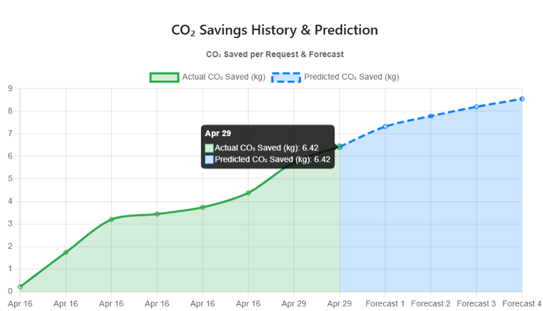
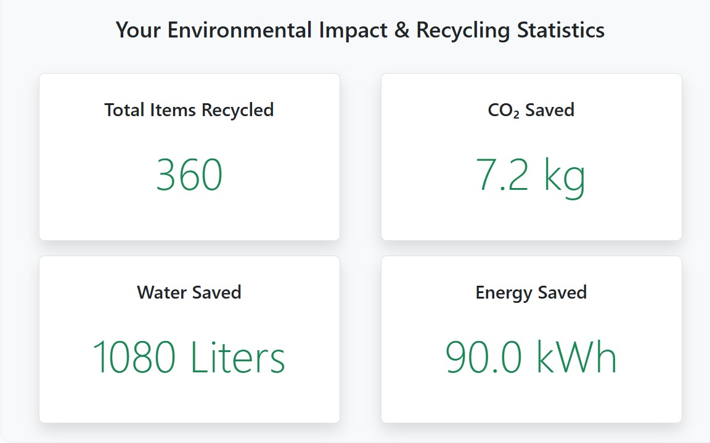
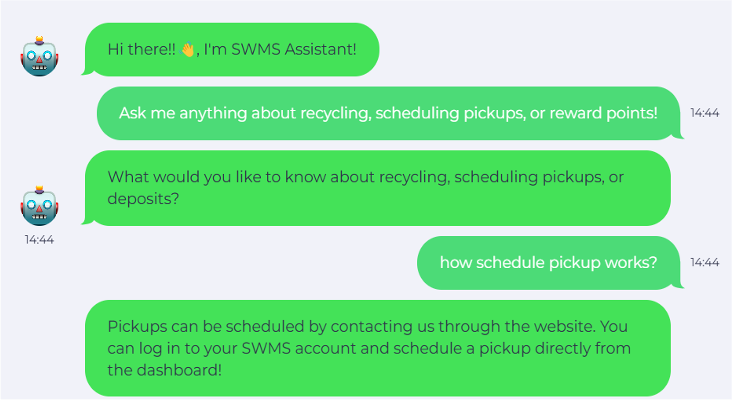

# ♻️ Smart Waste Management System


**Developed by [Raman Singh](https://github.com/ramansingh46)**

🔗 **Project Repository:** [Smart Waste Management System](https://github.com/ramansingh46/Smart-Waste-Management-System)

## 🌍 About the Project

The Smart Waste Management System is a web-based solution designed to make waste collection, recycling, and resource management more organized and efficient. It provides a centralized platform where users can request waste pickups, monitor their recycling contributions, and understand the positive environmental impact of their actions.

The application combines Django-based backend services, a responsive frontend, machine learning capabilities, and an interactive chatbot to create a more accessible waste management experience.

It also incorporates a reward mechanism that encourages responsible recycling practices through a points-based credit system inspired by Massachusetts Bottle Bill regulations.

> ♻️ Turning everyday recycling activities into measurable environmental impact.

---

## 📸 Project Screenshots

### Carbon Savings Prediction


### Recycling Statistics Dashboard


### AI Chatbot – LandBot


---

## 🚀 Core Functionalities

- **Pickup Request Management:** Users can submit waste collection requests by providing their ZIP code and the number of garbage bags.
- **Administrative Management:** Administrators can verify pickup requests, approve submissions, and allocate drivers.
- **Driver Management Panel:** Drivers can access assigned collection requests and update their progress.
- **Recycling & Reward Management:** Redemption workers can record recyclable materials and manage the corresponding reward credits.
- **Email Alert System:** Automated emails keep users informed about approvals, driver assignments, and collection updates.
- **Interactive Chatbot:** Landbot integration provides users with assistance and guidance regarding platform operations.
- **Personalized User Dashboard:** Displays individual recycling activity and environmental contributions, including:
  - Previous pickup records
  - Total recyclable items submitted
  - Estimated CO₂ emissions saved
  - Visual recycling statistics
  - Machine learning-based CO₂ savings predictions

---

## 🧠 Technology Stack

| Component | Technologies | Implementation |
|---|---|---|
| Frontend | HTML, CSS, JavaScript, Bootstrap | Responsive user interface |
| Backend | Python, Django | Application logic, authentication and role management |
| Database | PostgreSQL | User, pickup and recycling records |
| Machine Learning | Scikit-learn | Logistic Regression prediction model |
| Chatbot | Landbot.io | Interactive user assistance |
| Data Visualization | Matplotlib | Environmental statistics and graphical reports |
| Email Services | Django SMTP | Automated notifications |
| API Testing | Postman | API and workflow testing |
| Deployment | Render | Web application hosting |
| Version Control | Git & GitHub | Source code management |

---

## 📊 Machine Learning – Carbon Savings Prediction

The project incorporates a Logistic Regression model using Scikit-learn to estimate future environmental contributions based on recycling-related activities.

**Model Details:**

- **Algorithm:** Logistic Regression
- **Input Parameters:**
  - Number of recyclable items
  - Frequency of waste collection
  - Number of bags collected
- **Prediction Output:** Estimated future CO₂ emissions savings.

The prediction functionality adds a data-driven component to the platform, helping users understand and track their potential environmental impact.

---

## ⚙️ Installation & Execution

Follow these steps to set up the project locally.

**1. Clone the repository**

```bash
git clone https://github.com/ramansingh46/Smart-Waste-Management-System.git
cd Smart-Waste-Management-System
```

**2. Set up a virtual environment**

```bash
python -m venv venv
```

Activate it:

```bash
# Windows
venv\Scripts\activate

# Linux / macOS
source venv/bin/activate
```

**3. Install project dependencies**

```bash
pip install -r requirements.txt
```

**4. Configure database and apply migrations**

```bash
python manage.py makemigrations
python manage.py migrate
```

**5. Start the Django development server**

```bash
python manage.py runserver
```

Open the application at:

`http://127.0.0.1:8000/`

---

## 🎯 Project Objectives

- Encourage sustainable waste disposal and recycling habits.
- Simplify the coordination between users, administrators, and collection drivers.
- Maintain transparent records of recycling activities.
- Provide insights into environmental benefits through data visualization.
- Use machine learning to estimate potential carbon savings.
- Improve user engagement through digital assistance and reward-based participation.

---

## 👨‍💻 Developer

**Raman Singh**

B.Tech – Computer Science & Engineering (AI & ML)

[GitHub Profile](https://github.com/ramansingh46)

[View Project Repository](https://github.com/ramansingh46/Smart-Waste-Management-System)

---

## 📄 License

This project is distributed under the MIT License.
